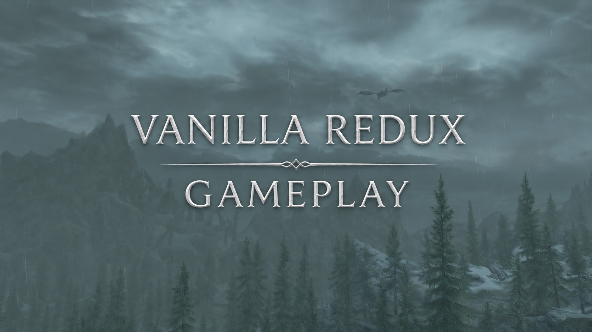

<!-- omit from toc -->
# Vanilla Redux - Gameplay

Wabbajack modlist installer by *ManulMadcap*

<table stlyle="border: none;">
<tr>
<td></td>
<td><a href="https://build.wabbajack.org/authored_files/download/Vanilla%20Redux%20-%20Gameplay.wabbajack_addff02c-a3d4-40fe-8636-dfe963020ca1">Download on Wabbajack</a></td>
<td></td>
<td><a href="https://discord.gg/D9EbH5rnY">Join us on Discord</a></td>
</tr>
</table>

[![CC BY-NC-SA 4.0][cc-by-nc-sa-shield]][cc-by-nc-sa]

[![CC BY-NC-SA 4.0][cc-by-nc-sa-image]][cc-by-nc-sa]

[cc-by-nc-sa]: http://creativecommons.org/licenses/by-nc-sa/4.0/
[cc-by-nc-sa-image]: https://licensebuttons.net/l/by-nc-sa/4.0/88x31.png
[cc-by-nc-sa-shield]: https://img.shields.io/badge/License-CC%20BY--NC--SA%204.0-lightgrey.svg

<!-- omit from toc -->

## Contents
- [Preamble](#preamble)
- [System Requirements](#system-requirements)
- [Installation](#installation)
  - [Pre-Installation](#pre-installation)
  - [Wabbajack Installation](#wabbajack-installation)
    - [Installing Wabbajack](#installing-wabbajack)
    - [Downloading and Installing Vanilla Redux Gameplay](#downloading-and-installing-vanilla-redux-gameplay)
      - [Problems with installation](#problems-with-installation)
  - [Post-Installation](#post-installation)
    - [BethINI Pie](#bethini-pie)
    - [Setting Up Shortcuts](#setting-up-shortcuts)
- [Playing the Modlist](#playing-the-modlist)
  - [Modlist Usage](#modlist-usage)
  - [Modlist Gameplay Quick Start Guide](#modlist-gameplay-quick-start-guide)
  - [Modlist Features](#modlist-features)
- [Updating the modlist](#updating-the-modlist)
- [Uninstalling the Modlist](#uninstalling-the-modlist)
- [Support](#support)
- [Author Information and Credits](#author-information-and-credits)

## Preamble

The **Gameplay** version of the **Vanilla Redux** includes a variety of mods that improve upon the vanilla Skyrim gameplay while staying true to its roots and vision. This modlist contains all of the fixes from [Vanilla Redux - Base](https://github.com/manulmadcap/vanilla-redux-base) modlist and also contains a minimal amount of visual enhancement mods.

A full list of mods included in the modlist can be found [here](https://loadorderlibrary.com/lists/vanilla-redux-gameplay).

> [!NOTE]
> This work is licensed under a [Creative Commons Attribution-NonCommercial-ShareAlike 4.0 International License][cc-by-nc-sa].

## System Requirements

> [!WARNING]
> Only Windows 10 and 11 are fully supported with Wabbajack (WJ). No other operating systems are officially supported.

***

| | Requirements | Info |
| :---: | :---: | :---: |
| **Game** | GOG Skyrim Special Edition | Steam version is **not supported** |
| **Operating System** | Windows 10/11 (64bit) | Windows 11 is currently **untested** |
| **CPU** | 4 Core/ 4 Threads | Intel i5-7500 or newer or AMD equivalent. ARM & 32bit not supported. |
| **RAM** | 16 GB | 32 GB preferrable |
| **GPU** | 4 GB Vram | Nvidia 970 or AMD R9 390 or newer |
| **Space** | 140 GB | Solid-state drive (SSD) required for 90 GB of the 140 GB total size. |

## Installation

### Pre-Installation

> [!CAUTION]
> The following must be downloaded and installed before Wabbajack installation:
> * [Microsoft Visual C++ Redistributable 2017-2026 x64](https://learn.microsoft.com/en-us/cpp/windows/latest-supported-vc-redist)
> * [Microsoft .NET Desktop Runtime 4.8 x64](https://dotnet.microsoft.com/en-us/download/dotnet-framework/net48)
> * [Microsoft .NET Desktop Runtime 10 x64](https://dotnet.microsoft.com/en-us/download/dotnet/10.0)
> * [7-Zip](https://www.7-zip.org/)

***

Prior to installing the **Vanilla Redux**, please complete the following steps.

1. Download and install the **GOG version** of Skyrim Special Edition to a solid-state drive.
1. If necessary, change the language of the game to English. Other languages are not supported.
1. Launch the game and reach the main menu. Allow it to download any addon files if needed.
1. Close the game.
1. Either uninstall the **Steam version** of Skryim Special Edition, **OR** disable it by closing Steam and renaming the game's manifest file `<A-Z>:\SteamLibrary\steamapps\appmanifest_489830.acf` to `appmanifest_489830.acf.disabled`.

>[!CAUTION]
>**Make sure the Steam version of the game is uninstalled or disabled before running Wabbajack.**

***

### Wabbajack Installation

#### Installing Wabbajack

1. Download the latest version of Wabbajack from their official site [https://www.wabbajack.org/](https://www.wabbajack.org/).
1. Save it to a location close to the root of the drive (For example, `C:\wabbajack`) and on the same SSD as the install of the game.
1. Run the `Wabbajack.exe` file that was downloaded.
1. In the bottom left, click on `Settings`.
1. Under `Logins`, login to your [Nexus Mods](https://www.nexusmods.com/) account.
1. Once your Nexus Mods account is logged in, close Wabbajack.

#### Downloading and Installing Vanilla Redux

Downloading and installing the **Vanilla Redux** can take a while depending on your internet connection and depending on whether you have [Nexus Mods Premium](https://www.nexusmods.com/premium). To install the **Vanilla Redux**, complete the following steps:

1. Close Wabbajack if it's open.
1. Download the **Vanilla Redux** `.wabbajack` file from the [Wabbajack CDN](https://build.wabbajack.org/authored_files/download/Vanilla%20Redux%20-%20Gameplay.wabbajack_addff02c-a3d4-40fe-8636-dfe963020ca1).
1. Open the `Vanilla Redux - Gameplay.wabbajack` file with Wabbajack.
1. For `Installation Location`, choose a location close to the root of the drive, not in a protected folder/location, and on the same solid-state drive as the install of the GOG version of Skyrim (For example, `C:\wabbajack\vanilla-redux-gameplay`).
1. For `Downloads Location`, it's generally recommended to let Wabbajack automatically set this (Wabbajack sets it to same path as `Installation Location` except with `\downloads` added to it). However, this can be set to any other location or drive to save solid-state drive space.
1. Click `Install`.
1. Once the install completes, click on `Create Desktop Shortcut` and then close Wabbajack.
1. Double click the desktop shortcut that was created to open Mod Organizer 2, which is used to run the game.
1. In the top right corner, click the `Shortcut` dropdown menu, and choose `Desktop`.
1. Close Mod Organizer 2.

Problems with Installation

The Wabbajack log files can be found in the version folder that gets automatically created in the same folder as the `wabbajack.exe` file in the `logs\` folder. Some common Wabbajack issues are listed below.

* **Could not download X:**
    * Big files can fail to download due to connection issues. You can either run wabbajack again or download the file manually. If you decide to manually download it, make sure to place it in the same place as the other downloads.

* **X is not a whitelisted download:**
    * This will happen when we update the modlist. Please check if there is a new update or wait until you see a release ping.

* **Wabbajack could not find the game folder:**
    * Make sure the **GOG version** of Skyrim Special Edition is properly installed to the same SSD as Wabbajack.

* **Unable to download `Data_ccbgssse037-curios`:**
    * Make sure your version of the `Rare Curios` addon is acquired from within the game and not from verifying the game through Steam.

***

### Post-Installation

#### BethINI Pie

`BethINI PIE` is an application used to configure and manage the `Skyrim.ini` and `SkyrimPrefs.ini` configuration files. These files control the game's graphical settings and should be configured after the modlist has been installed.

1. Open the installation folder and run the program `ModOrganizer.exe`.
1. In the top right corner, click on the large dropdown box, and set it to `BethINI PIE`.
1. Click on the `Run` button next to the dropdown box.
1. Ensure that the tab `Basic` is selected.
1. Under the `Display` section, configure the `Resolution` setting to match your display's resolution.
1. Click on `File` and then `Save`.
1. For each of the subsequent popup windows, click `Save`.

> [!NOTE]
> If you find that the game isn't able to run smoothly with your hardware, under the `Presets` section of the `Basic` tab, try selecting one of the lower `Bethini Presets` such as `Low` or `Medium`.

#### Setting Up Shortcuts

1. Open the installation folder and run the program `ModOrganizer.exe`.
1. In the top right corner, make sure the large dropdown box is set to `Skyrim Special Edition`.
1. In the top right corner, click the `Shortcut` dropdown menu, and choose `Desktop`.
1. Close `Mod Organizer 2`.

## Playing the Modlist

### Modlist Usage

* To play the game, run the `Skryim Anniversary Edition` desktop shortcut that was created.
* Save files are stored in `<installation location>\profiles\default\saves\`.
* The `Skyrim.ini` and `SkyrimPrefs.ini` files are stored in `<installation location>\profiles\default\`. Run the `BethINI` application via `Mod Organizer 2` to configure these files.
* Screenshots are taken using the Print Screen `PrtScn` keyboard key and are saved to `<installation location>\game-root\`.

### Modlist Gameplay Quick Start Guide

* New games start off in the character creation menu.
  * Make sure to pick a race, a class, and a trait to better personalize your character. Other options are purely cosmetic.
* After the character creation menu, you'll begin the game in a cell.
  * Wait 30 seconds for the mods to finish initializing
  * Interact with the statue of Mara at the far end of the cell to begin the game in whichever scenario you desire.
* Combat is more technical and impactful.
  * Stamina matters.
    * Stamina does not regenerate while attacking, blocking, or performing other actions.
    * Combatants who are out of stamina are slower, block less damage, and deal less damage with bows.
    * Actions such as drawing a bow, sneaking, or jumping cost stamina.
  * Staggering enemies is critical.
    * Staggered combatants take 50% more damage.
    * A small cooldown bar above the health bar indicates when the combatant is staggered.
    * Enemy attacks can be interrupted by staggering them while they are performing a power attack, drawing a bow, or casting a spell.
  * Attacks of opportunity
    * Hits on an enemy while they are power attacking, drawing a bow, or casting a spell deal 50% extra damage and 25% extra stagger.
  * Blocking is improved.
    * Blocking normal attacks with a shield has a 50% chance to stagger the enemy.
    * Bashing a foe with a shield who is power attacking will stagger them and cancel their attack.
    * Timing a block with a weapon within 1 second of an incoming attack will perform a parry, blocking more damage and staggering the enemy.
  * Unarmed combat is expanded.
    * Directional unarmed power attacks, sneak unarmed power attacks, and sprinting unarmed power attacks have been added.
    * A new skill tree for unarmed combat has been added, allowing you to build a viable character around it.
* An additional follower can be recruited to your party for every 30 speech levels that are gained.
* Lockpicking and pickpocketing have had their skill tree combines into one.
* Many perks have been slightly modified.
* There are dozens of new weapons, armor, and spells to acquire.
* Many things in the world that can be interacted with now have an alternate action that can be used by holding `SHIFT` or `LT`.
  * Resting at campfires instead of cooking at them.
  * Directly opening the inventory of a follower or horse.
  * Picking up an animal's corpse while hunting in order to bring it back to town.

### Modlist Features

**Base Modlist Features:**

* A full list of mods included in the modlist can be found [here](https://loadorderlibrary.com/lists/vanilla-redux-gameplay).
* Safe for work (SFW). No nudity or sexual content.
* Better third person item selection.
* Improved movement, such as jumping while sprinting.
* Improved character creation.
* Choice to start new games as usual or in other scenarios.
* Proper `Alt + Tab`'ing.
* Improved auto saving.
  * Traditional Skyrim auto saves and quicksaves have been replaced with normal "hard" saves (Still triggered automatically by the game). This was done due to the fact that traditional auto saves and quicksaves are notoriously unreliable and have the potential to corrupt save games.
  * Skyrim now performs a "hard" save automatically in the following conditions:
    * Every 10 minutes.
    * After combat.
    * On wait.
    * On sleep.
    * On discovering a location.
    * And only if another auto save has not occurred in the past 3 minutes.
* Numerous mods that improve stability and game reliability.
  * Examples include [SSE Engine Fixes](https://www.nexusmods.com/skyrimspecialedition/mods/17230), [Unofficial Skyrim Special Edition Patch](https://www.nexusmods.com/skyrimspecialedition/mods/266), [Recursion Monitor](https://www.nexusmods.com/skyrimspecialedition/mods/76867), and [GOG Memory (VRAM) Leak Fix](https://www.nexusmods.com/skyrimspecialedition/mods/169302).
* Numerous fixes in things like settings, scripts, quests, and meshes.
* The [Skyrim Script Extender (SKSE)](https://www.nexusmods.com/skyrimspecialedition/mods/30379) is installed, along with many other mod frameworks to support usual modding activities.
* Vanilla Skyrim `.esm` plugins have been cleaned.
* All plugin conflicts have been resolved or had their intentional conflicts properly "hidden" via `.modgroup` files in acccordance with [The Method](https://tes5edit.github.io/docs/6-themethod.html).

**Gameplay Modlist Features:**

* A full list of mods included in the modlist can be found [here](https://loadorderlibrary.com/lists/vanilla-redux-gameplay).
* Beyond Skyrim - Bruma: https://www.nexusmods.com/skyrimspecialedition/mods/10917
* Missives: https://www.nexusmods.com/skyrimspecialedition/mods/17576
* Radiant Quest Point System: https://www.nexusmods.com/skyrimspecialedition/mods/67956
* Overhauls to the following gameplay aspects:
  * Shouts:
    * Stormcrown: https://www.nexusmods.com/skyrimspecialedition/mods/90659
  * Combat:
    * Blade and Blunt: https://www.nexusmods.com/skyrimspecialedition/mods/34549
    * Parry: https://www.nexusmods.com/skyrimspecialedition/mods/133437
    * Unarmed combat: https://www.nexusmods.com/skyrimspecialedition/mods/131607
    * New weapons and armor.
    * New enchantments:
      * Summermyst: https://www.nexusmods.com/skyrimspecialedition/mods/6285
    * New spells.
      * Mysticism: https://www.nexusmods.com/skyrimspecialedition/mods/27839
      * Lost Grimoire: https://www.nexusmods.com/skyrimspecialedition/mods/4455
    * Arachnomancy: https://www.nexusmods.com/skyrimspecialedition/mods/67272
  * Races:
    * Aetherius: https://www.nexusmods.com/skyrimspecialedition/mods/26686
  * Classes:
    * Apprentice: https://www.nexusmods.com/skyrimspecialedition/mods/169288
  * Perks:
    * Adamant: https://www.nexusmods.com/skyrimspecialedition/mods/30191
    * Unarmed perk tree: https://www.nexusmods.com/skyrimspecialedition/mods/59790
  * Followers:
    * Simple Follower Framework: https://www.nexusmods.com/skyrimspecialedition/mods/174017
    * Additional follower available every 30 Speech levels.
  * Hunting:
    * Simple Hunting Overhaul: https://www.nexusmods.com/skyrimspecialedition/mods/95943
* Improved movement:
  * True Directional Movement: https://www.nexusmods.com/skyrimspecialedition/mods/51614
  * Jumping Attack: https://www.nexusmods.com/skyrimspecialedition/mods/68043
  * Better Jumping SE: https://www.nexusmods.com/skyrimspecialedition/mods/18967
* Dynamic Activation Key:
  * https://www.nexusmods.com/skyrimspecialedition/mods/96273
  * https://www.nexusmods.com/skyrimspecialedition/mods/96430
* Even Better Quest Objectives: https://www.nexusmods.com/skyrimspecialedition/mods/159

## Updating the Modlist

Before updating, please check the changelog and back up your saves. Save files are stored in `<installation location>\profiles\default\saves\`.

Updating the modlist uses the same process as installing the modlist. Make sure the `Installation Location` and `Downloads Location` paths are the same as your initial install.

>[!CAUTION]
> Any mods you have added or changes to mods that you've made will be **deleted** when updating.

## Uninstalling the Modlist

Delete the install location folder and any desktop shortcuts that were created.

>[!CAUTION]
> Saves are stored in `<installation location>\profiles\default\saves\`, so deleting the install location folder will also delete your saves.

## Support

Only the latest version of the modlist is supported. No exceptions.

If you encounter bugs with the modlist, open a new issue [here](https://github.com/manulmadcap/vanilla-redux-gameplay/issues). Please check for existing issues first.

No support is provided for users who added, modified, or removed mods. Support is only provided for the latest version of the modlist without any modifications made to it.

## Author Information and Credits

* ManulMadcap - Author/main developer of the **Vanilla Redux**.
* Al/Styyx Setup of Skyrim ASSOS - Thanks for their `README.md` template.

<!--
modlist_metadata:
  version: "1.0.0"
  name: "vanilla-redux-gameplay"
  pretty_name: "Vanilla Redux - Gameplay"
  author: "ManulMadcap"
  mo2_profile: "vanilla-redux"
  readme: "https://github.com/manulmadcap/vanilla-redux-gameplay/blob/main/README.md"
  website: "https://github.com/manulmadcap/vanilla-redux-gameplay"
  discord: "https://discord.gg/D9EbH5rnY"
  machine_url: "VanillaRedux/VanillaReduxGameplay"
  image: "https://raw.githubusercontent.com/manulmadcap/vanilla-redux-gameplay/refs/heads/main/docs/images/vanilla-redux-gameplay-thumbnail.jpg"
  load_order_library: "https://loadorderlibrary.com/lists/vanilla-redux-gameplay"
  wabbajack_cdn: "https://build.wabbajack.org/authored_files/download/Vanilla%20Redux%20-%20Gameplay.wabbajack_addff02c-a3d4-40fe-8636-dfe963020ca1"
-->
